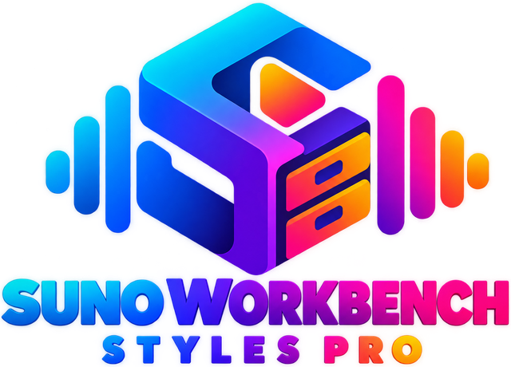

<p align="center">
  
</p>

# Suno Workbench

[](https://github.com/iamsevnth/suno-styles-workbench/actions/workflows/deploy.yml)

A free, browser-only toolkit for Suno v6. Suno Workbench creates detailed Styles prompts, repairs existing prompts that need a clearer musical hierarchy, and builds lyrics around a user-controlled song structure. Everything stays in your browser.

**Live site:** https://sunoworkbench.com  
**Guide:** https://sunoworkbench.com/guide  
**Privacy Policy:** https://sunoworkbench.com/privacy-policy

| Tool | What it does |
| --- | --- |
| **Styles Compiler** | Creates one to six 925–975 character Styles prompts from a short brief, or rebuilds an existing Suno Styles prompt in **Fix Existing Prompt** mode. |
| **Lyrics Studio** | Builds a song section by section with exact line counts, custom section ordering, Suno section tags and American-English phonetic respelling. |
| **Guide** | A complete, locally searchable reference manual migrated from a 157-page DOCX, with chapter navigation, the 59-section sonic encyclopedia, recipes, genre and lexicon appendices, verified v4 instructions, and official Suno v6 controls. |

There is no application server, account, analytics service, cookie, API key or AI API call. Compilation and lyric processing run locally. The site also ships as one self-contained `suno-workbench.html` file that works offline.

## Styles Compiler

The compiler parses a brief into musical intent, maps recognized genres to sound families, plans a sonic arrangement, renders the result into the Styles character window and validates it before returning a prompt.

Every generated Styles prompt is designed to:

- stay between 925 and 975 characters;
- contain one whole-number BPM;
- preserve recognized genres, named instruments and important vocal details;
- use genre-family vocabulary instead of a generic production pool;
- use positive production language rather than negative instructions;
- avoid artist-name imitation language; and
- keep lyric lines and section tags out of the Styles field.

### Create From Brief

Start with the few facts that must survive: lead genre, BPM, voice, signature instruments, groove and mood. Workbench fills the missing production details from the appropriate sound family.

### Fix Existing Prompt

Paste a Styles prompt that already ran in Suno. Fix mode reparses the musical intent and rebuilds the prompt in rewrite mode. It is intended to reduce conflicting instructions, clean up negative wording, focus the genre hierarchy and recover a single coherent tempo while preserving detected genres, BPM, instruments, groove/bass cues and vocal traits.

## Lyrics Studio

Lyrics Studio includes the existing **Modular Song Structure Order (Custom Sequence)** builder. Sections can be added, duplicated, reordered and assigned their own line counts before generation. The longer-term overhaul plan for making this custom sequence the center of Lyrics Studio is documented in [docs/LYRICS_STUDIO_OVERHAUL.md](docs/LYRICS_STUDIO_OVERHAUL.md).

## Complete searchable Guide

The `/guide` page now contains a chapter-based edition of the author's long-form engineering and production manuscript. The reference content is committed as Markdown in `src/content/guide/manuscript/`; current v4 and official Suno chapters live in `src/content/guide/verified/`.

Search and navigation run in-browser and in the self-contained offline edition, with no network requests or analytics. Each historical chapter carries source-status and v4-reconciliation notes: retired Skills Studio workflows, old prompt title/ID formats, legacy module paths and retired models are not presented as current features. The historically oversized example prompts are **not** validated copy-ready output. A live Genre Coverage chart is computed from the actual library rather than copied from the manuscript.

When editing the manual, update the Markdown chapter and the stable index in `src/lib/guide/manifest.ts`; do not paste new prose into a giant TSX component. Validate the index with `npm test` and the bundled HTML with `npm run build`.

## Suno Create Mode guidance

The Guide uses Suno's official Help Center as the primary source for current v6 Create controls:

- [Creative Sliders](https://help.suno.com/en/articles/6141377)
- [v6 FAQ](https://help.suno.com/en/articles/13924481)
- [What's new in v6](https://help.suno.com/en/articles/13924801)

Important distinctions include:

- **v6:** flagship Pro/Premier model for reliable, precise, polished generations.
- **v6-wild:** exploratory Pro/Premier model for less predictable ideas.
- **v6-mini:** faster/lighter v6 variant available on all plans.
- **Weirdness:** Safe → Chaos; Suno documents 50% as the normal expected-result position.
- **Style Influence:** Loose → Strong adherence to style input.
- **Audio Influence:** Loose → Strong when an audio upload is present.
- **Variety:** changes/updates style prompts; set to 0 to retain full control of style tags.
- **Max Mode:** higher-compute, higher-credit option intended for demanding generations such as longer songs and consistency-sensitive work.

Exact UI labels, plan gates and credit behavior can change; Suno's current Help Center and Release Notes take precedence.

## Privacy and offline use

The dedicated [Privacy Policy](https://sunoworkbench.com/privacy-policy) explains the data model in detail. In short:

- prompts, lyrics, Styles text and generated content are processed locally;
- SEVNTHLABS does not receive that creative content;
- session state and Styles history use browser storage on the user's device;
- the site itself uses no cookies, analytics or tracking; and
- GitHub Pages hosts the public site and may process limited hosting/security logs under GitHub's own infrastructure and policies.

See [SECURITY.md](SECURITY.md) for security architecture and vulnerability reporting.

## Development

Requires Node.js 22 or later.

```bash
npm ci
npm run dev
npm test
npm run lint
npm run build
npm run preview
```

The build creates clean hosted routes for `/`, `/compiler`, `/lyrics`, `/guide` and `/privacy-policy`, plus the self-contained offline HTML file. Pull requests run type-checking, tests, build checks, CodeQL and dependency review.

### Project layout

```
src/
  App.tsx
  routes.ts
  pages/
    HomePage.tsx
    PrivacyPolicyPage.tsx
    guide/
  content/
    guide/
      verified/
      manuscript/
  components/
    content/
    layout/
    studio/
    styles/
    LyricsStudio.tsx
  hooks/
  lib/
    suno/
    lyrics/
    browser/
scripts/
tests/
docs/
  LYRICS_STUDIO_OVERHAUL.md
```

## Light and dark mode

The UI uses the same brand spectrum in both themes. Theme colors are CSS variables in `src/index.css`. The responsive Guide reader, colored sections, and source-backed Genre Coverage chart derive their colors from those variables rather than hard-coded single-theme values.

## Credits

- Label font: [Atkinson Hyperlegible](https://www.brailleinstitute.org/freefont/) by the Braille Institute, SIL Open Font License.
- Icons: [Lucide](https://lucide.dev) (ISC License) and the GitHub mark from [Octicons](https://primer.style/octicons) (MIT License).

## Contact

Questions, ideas or broken features: [mateus@sevnthlabs.com](mailto:mateus@sevnthlabs.com). Security issues should use the private reporting process in [SECURITY.md](SECURITY.md).

## Not affiliated with Suno

Suno Workbench is an independent SEVNTHLABS project. It is not affiliated with or endorsed by Suno, Inc.
