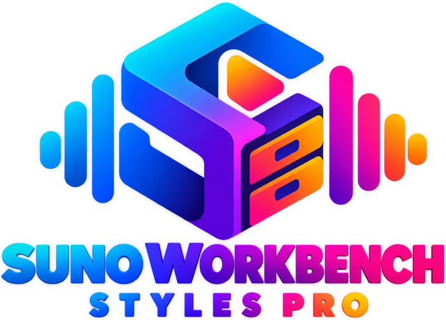

<p align="center">
  
</p>

# Suno Workbench

[](https://github.com/iamsevnth/suno-styles-workbench/actions/workflows/deploy.yml)
[](https://github.com/iamsevnth/suno-styles-workbench/actions/workflows/readme-score.yml)

A free, browser-only toolkit for Suno v6. Suno Workbench creates detailed Styles prompts, repairs existing prompts, audits detectable source-to-output prompt fidelity, rearranges lyrics supplied by the user without inventing lyric words, and includes a locally searchable production guide. Creative content stays in the browser.

**Live Site:** https://sunoworkbench.com  
**Guide:** https://sunoworkbench.com/guide  
**Official v5.3 Release:** [suno-workbench-sevnthlabs-v5.3](https://github.com/iamsevnth/suno-styles-workbench/releases/tag/v5.3.0)  
**Privacy Policy:** https://sunoworkbench.com/privacy-policy  
**Security Policy:** [SECURITY.md](SECURITY.md)

## Features

| Tool | What It Does |
| --- | --- |
| **Styles Compiler** | Creates one to six 800–975-character Styles prompts from a brief or repairs existing prompts. The **Prompt Fidelity Inspector** audits text-level preservation against the source, including the separate Exclude field; it does not assign musical-quality scores. |
| **Lyrics Studio** | Rearranges original user-supplied lyrics into a manual or suggested section sequence using planned bar slots, chopping, repetition, verified source spans, local project saves, and optional American-English phonetic conversion. No new lyric words are generated. |
| **Guide** | Includes current v5.3 getting-started instructions, dedicated Prompt Fidelity Inspector and v5.2 Lyrics Arranger walkthroughs, documented Suno v6 controls, and a separately labeled historical manuscript with searchable recipes and a 59-section sonic encyclopedia. |
| **Offline Build** | Produces a self-contained <code>dist/suno-workbench.html</code> file that runs directly from disk without a server. |
| **Privacy-First Runtime** | Uses no application server, account system, analytics service, cookies, API keys, or AI API calls. |

The hosted app and offline build are designed to keep briefs, lyrics, Styles text, and generated content on the user's device. Session state and Styles history use browser storage only. Lyrics Studio saves its source texts to local browser storage only when the user explicitly selects Save to Browser.

## Installation

### Use the Hosted App

No installation is required for normal use. Open https://sunoworkbench.com in a current browser.

### Local Development

Requirements:

- Node.js 22 or later
- npm
- Git

Clone the repository and install the exact dependency versions from <code>package-lock.json</code>:

```bash
git clone https://github.com/iamsevnth/suno-styles-workbench.git
cd suno-styles-workbench
npm ci
npm run dev
```

The development server listens on <code>127.0.0.1</code> by default.

When intentionally adding or updating a dependency, use <code>npm install package-name</code> so both <code>package.json</code> and <code>package-lock.json</code> are updated together. Normal CI and reproducible local validation should continue to use <code>npm ci</code>.

### Offline Build

Build the hosted site and self-contained offline edition with:

```bash
npm run build
```

The offline application is written to:

```text
dist/suno-workbench.html
```

Open that file directly in a current desktop browser. The offline builder inlines the application assets and rewrites the Content Security Policy to permit only the exact inlined scripts and styles by SHA-256 hash.

### Official v5.3 Standalone Download

The official [GitHub v5.3.0 Release](https://github.com/iamsevnth/suno-styles-workbench/releases/tag/v5.3.0) is titled **suno-workbench-sevnthlabs-v5.3** and includes the self-contained HTML as a direct **release asset**, not merely the source-code ZIP.

- **[suno-workbench-sevnthlabs-v5.3.html](https://github.com/iamsevnth/suno-styles-workbench/releases/download/v5.3.0/suno-workbench-sevnthlabs-v5.3.html)** — one-file offline application with the refreshed v5.3 Guide, compiler, Fidelity Inspector, Lyrics Arranger and phonetics.
- **[SHA-256 checksum](https://github.com/iamsevnth/suno-styles-workbench/releases/download/v5.3.0/suno-workbench-sevnthlabs-v5.3.html.sha256)** — allows verification of the downloaded HTML.

The standalone file is rebuilt from the validated release commit with `npm run build`, the complete test suite, TypeScript checking and the offline Content Security Policy validator before publication. No installation or account is needed for core offline use; external links to Suno documentation need an internet connection.

To verify on Linux, place both downloads in one directory and run `sha256sum -c suno-workbench-sevnthlabs-v5.3.html.sha256`. On macOS, run `shasum -a 256 suno-workbench-sevnthlabs-v5.3.html` and compare its digest with the checksum file.

## Usage and Examples

### Styles Compiler

Start with the musical facts that must survive: lead genre, BPM, voice, signature instruments, groove, and mood.

Example brief:

```text
Dark melodic dubstep at 150 BPM, female lead vocal, cinematic strings,
sub-heavy bass, emotional build, wide supersaws, aggressive but polished drop.
```

Workbench maps recognized genres to sound families, plans the sonic hierarchy, and renders the result into the Styles character window.

### Fix Existing Prompt

Use **Fix Existing Prompt** when a prompt already produces something useful but contains conflicting instructions, an unclear genre hierarchy, negative wording, or multiple competing tempos. The rebuild attempts to preserve detected genres, BPM, named instruments, groove/bass cues, and vocal traits while making the prompt more coherent. When long or conflicting source prompts require recompilation, results may show **Check source retention** warnings for recognizable instructions that did not survive. These warnings are text-level review indicators, not a guarantee of complete semantic fidelity or audible quality.

### Prompt Fidelity Inspector

After generating or fixing, expand **Prompt Fidelity Inspector** below a result. It compares the original brief (or the original pre-Fix prompt) to that exact output, including the separate Exclude field. Findings identify **Text Matched**, **Explicit Difference**, **Not Detected**, and **Review Needed** with individual source snippets and observations. You can export the full comparison as JSON locally.

In Fix Mode, you may optionally paste a still-earlier **Original Intent / Brief** inside the inspector to compare both the pre-Fix prompt and the fixed result against the same source. Without that reference, the pre-Fix prompt itself is the only known baseline. The extra reference is not saved to browser history or sent to a server.

These are text-based diagnostics, not scores for musical creativity or predictions of Suno audio output. See [Methodology and Suno source documentation](docs/PROMPT_FIDELITY_METHODOLOGY.md).

### Lyrics Studio

Lyrics Studio now arranges **existing user-supplied lyrics only**. Paste an entire song using optional section headings, or supply separately labeled source sections. Choose a suggested arrangement or create your own Intro → Chorus → Build Up → Drop → Breakdown → Drop sequence. Each destination uses explicit **planned bar slots**, a source selection, and either original-line rearrangement or source-phrase chopping.

For example, an original 16-line chorus can supply an eight-slot buildup and a sixteen-slot drop by reusing the original words. One input line is **not intrinsically one musical bar**. The app gives timing and repetition warnings rather than claiming it can transcribe audio or guarantee the result at a particular BPM. Every output lyric phrase is checked against the exact source spans; output is read-only and includes a Source Map.

Use **Save to Browser** for an explicit local save, **Export Project JSON** for backups, and **Copy to Suno** for the verified output. No AI service, API, model downloads, or new lyric generation is involved. The optional Phonetics Converter remains accessible in its separate tab. See [Lyrics Studio details](docs/LYRICS_STUDIO_OVERHAUL.md).

### Guide

Open https://sunoworkbench.com/guide for the searchable production reference. The Guide now starts with **Workbench v5.3 — Start Here**, and includes dedicated **Prompt Fidelity Inspector — v5.3** and **Lyrics Studio Arranger — v5.2+** chapters. It also contains verified Suno controls, reconciliation notes, and a clearly labeled historical source manuscript. Search and navigation run locally in the hosted and offline editions.

## Styles Compiler

The compiler parses a brief into musical intent, maps recognized genres to sound families, plans a sonic arrangement, renders the result into the Styles character window, and validates it before returning a prompt.

The compiler's internal numerical candidate score is a heuristic for choosing between generated texts, not an empirically validated Suno prompt-quality score or prediction of the resulting audio. The 800–975-character target is a Workbench design choice, not a Suno-certified optimum.

Every generated Styles prompt is designed to:

- target 800–975 characters and never exceed 1,000;
- contain one whole-number BPM;
- preserve recognized genres, named instruments, and important vocal details;
- use genre-family vocabulary instead of a generic production pool;
- use positive production language rather than negative instructions;
- avoid artist-name imitation language; and
- keep lyric lines and section tags out of the Styles field;
- carry the brief's own scene, texture and instrument words (for example "sunset rooftop", "vinyl crackle", "acoustic guitar") into the prompt, and never swap acoustic for electric;
- pass an unknown genre word through exactly as written and say so in the genre notes, instead of silently falling back to bass music; and
- pass a contradiction gate (conflicting BPMs, vocals in an instrumental, clashing moods, bass-music phrasing in a non-bass genre).

Techno, house, lo-fi/jazz, folk/indie, rock/punk, metal, country, synthwave, pop, ambient and cinematic briefs use their own phrase banks (`src/lib/suno/native/`). The compiler adds detail only until the prompt reaches the window, so there is no filler text. Everything runs offline in the browser with no LLM or API calls.

Bass, club and rap genres have their own dedicated banks too (`src/lib/suno/native/catalog-edm.ts`): bass EDM, bass house, dubstep, brostep, deep dubstep, UKG dubstep, wobble bass, glitch bass, drum & bass, drumstep, UK garage, future bass, future house, future beats, EDM trap, moombahton, baile funk, afro tech house, modern rap, trap rap and autotuned sung-rap, plus riddim, tearout, deathstep, phonk (with drift phonk and Brazilian phonk), UK drill and NY drill. Sibling genres use different drums, bass design, leads, vocals, arrangement and BPM ranges. A hard gate (`noGenreBleed`, the `non_edm_bleed` contradiction) fails any prompt for these genres that carries acoustic, band, orchestral or lo-fi wording the brief did not ask for (phonk alone may use cassette and lo-fi grit); blends such as "dubstep + baile funk" stay inside the bass and rap world. Rap and sung-rap lyrics use bracketed delivery tags (`[Verse 1 | autotuned sung-rap, melodic]`, `[Hook | chant]`) and bracketed ad-libs.

### Create From Brief

Start with the few facts that must survive: lead genre, BPM, voice, signature instruments, groove, and mood. Workbench fills the missing production details from the appropriate sound family.

### Fix Existing Prompt

Paste a Styles prompt that already ran in Suno. Fix mode reparses the musical intent and rebuilds the prompt in rewrite mode. It is intended to reduce conflicting instructions, clean up negative wording, focus the genre hierarchy, and recover a single coherent tempo while preserving detected genres, BPM, instruments, groove/bass cues, and vocal traits.

### Prompt Fidelity Inspector

Every output can be evaluated against the actual original input saved with its compiler run. The v5.3 inspector separates explicit text matches, conflicting facts, undetected lexical evidence, and unresolved cases. It checks recognized BPMs/ranges, keys, time signatures, genres, instruments, voice and arrangement cues, source phrases, and Exclude-field instructions. Its exported JSON includes traceable observations and official Suno Help links for relevant field behavior.

**No empirical audio-quality rating is supplied.** The detector is a limited rule-based text auditor; unrecognized requirements are not counted as preserved, paraphrased facts can appear as Not Detected, and any audible outcome requires generation and listening evidence. See the [complete methodology](docs/PROMPT_FIDELITY_METHODOLOGY.md).

## Lyrics Studio

Lyrics Studio is a **source-preserving song arrangement workspace**, not a lyric writer. Users provide all lyric words. The arranger may reorder, repeat and chop original lines, while source IDs, line numbers and character offsets demonstrate where each output phrase originated. An integrity check blocks unverified output.

The user configures destination sections, optional source section mappings and 1–64 planned bar slots. The engine uses seeded variation and optional approximate end-rhyme grouping, with conservative order preservation for locked material. BPM and syllable-density estimates are advisory, **not proven audio or cadence analysis**.

Projects can be explicitly saved to the current browser and exported as validated JSON for backup; TXT and clipboard export produce Suno-ready text. The existing American Phonetics Converter remains available. See [design details and limitations](docs/LYRICS_STUDIO_OVERHAUL.md) and [v5.2.0 release notes](docs/releases/v5.2.0.md).

## Guide and Suno Create Mode Reference

The <code>/guide</code> page contains **current v5.3 documentation** alongside a preserved long-form engineering and production manuscript. The historical manuscript remains in <code>src/content/guide/manuscript/</code>; current Workbench v5.3 introductory material, verified product references, Fidelity Inspector guidance, Lyrics Arranger instructions and reconciliation notes live in <code>src/content/guide/verified/</code>. The historical 157-page source is not silently represented as a current feature specification.

Search and navigation run in-browser and in the self-contained offline edition, with no network requests or analytics. Historical chapters carry source-status and reconciliation notes so retired workflows, legacy prompt formats, and obsolete model behavior are not presented as current features.

When editing the manual, update the Markdown chapter and the stable index in <code>src/lib/guide/manifest.ts</code>. Do not paste new manual prose into a giant TSX component. Validate the index with <code>npm test</code> and the bundled HTML with <code>npm run build</code>.

The Guide uses Suno's official Help Center as the primary source for current product controls:

- [Creative Sliders](https://help.suno.com/en/articles/6141377)
- [v6 FAQ](https://help.suno.com/en/articles/13924481)
- [What's New in v6](https://help.suno.com/en/articles/13924801)

Exact UI labels, plan gates, model availability, and credit behavior can change. Current Suno Help Center and Release Notes information takes precedence over historical guidance in the repository.

## Privacy and Offline Use

The dedicated [Privacy Policy](https://sunoworkbench.com/privacy-policy) explains the data model in detail. In summary:

- prompts, lyrics, Styles text, and generated content are processed locally;
- SEVNTHLABS does not receive that creative content;
- session state and Styles history use browser storage on the user's device;
- the site itself uses no cookies, analytics, or tracking; and
- GitHub Pages may process limited hosting/security logs under GitHub's own infrastructure and policies.

The hosted build uses a restrictive Content Security Policy. The offline edition uses hash-pinned inline scripts and styles and does not require an application backend.

## API and Developer Reference

Suno Workbench intentionally has **no public server API** and no application backend. The runtime is a client-side React/Vite application.

### Application Routes

| Route | Purpose |
| --- | --- |
| <code>/</code> | Home and product entrypoint |
| <code>/compiler</code> | Styles Compiler |
| <code>/lyrics</code> | Lyrics Studio |
| <code>/guide</code> | Searchable production guide |
| <code>/privacy-policy</code> | Privacy policy |

The build process creates clean hosted route files, <code>404.html</code>, <code>sitemap.xml</code>, and <code>robots.txt</code>.

### Internal Code Reference

| Path | Responsibility |
| --- | --- |
| <code>src/lib/suno/</code> | Styles parsing, planning, rendering, validation and evidence-bound textual fidelity analysis |
| <code>src/lib/lyrics/</code> | Source-preserving arrangement, provenance checks, local project schema, legacy generator tests and phonetics |
| <code>src/lib/browser/</code> | Browser-local persistence and runtime helpers |
| <code>src/content/guide/</code> | Guide source material and verified reference content |
| <code>scripts/build-routes.mjs</code> | Hosted clean-route generation |
| <code>scripts/build-offline.mjs</code> | Self-contained offline HTML generation |
| <code>scripts/check-csp.mjs</code> | Content Security Policy validation |

## Development and Validation

Use the following validation sequence before submitting a change:

```bash
npm ci
npm run lint
npm test
npm run build
```

To preview the production build locally:

```bash
npm run preview
```

Pull requests run type-checking, tests, build validation, CodeQL, dependency review, and README Score. GitHub Actions are pinned to full commit SHAs. Dependabot proposes weekly npm and GitHub Actions updates.

The deployment workflow publishes to GitHub Pages only after the build job succeeds on <code>main</code>.

## Project Layout

```text
src/
  App.tsx
  routes.ts
  pages/
    HomePage.tsx
    PrivacyPolicyPage.tsx
    guide/
  content/
    guide/
      verified/
      manuscript/
  components/
    content/
    layout/
    studio/
    styles/
    LyricsStudio.tsx
    ArrangerStudio.tsx
  hooks/
  lib/
    suno/
    lyrics/
    browser/
scripts/
tests/
docs/
  LYRICS_STUDIO_OVERHAUL.md
```

## Contributing

See [CONTRIBUTING.md](CONTRIBUTING.md) for the supported development workflow, validation requirements, privacy/security constraints, and pull-request expectations.

At minimum, contributors should:

1. create a focused branch;
2. make the smallest change needed;
3. keep the browser-only privacy model intact;
4. run <code>npm run lint</code>, <code>npm test</code>, and <code>npm run build</code>; and
5. submit the change through a pull request.

Security vulnerabilities should **not** be reported in a public issue or pull request. Follow [SECURITY.md](SECURITY.md).

## Security

See [SECURITY.md](SECURITY.md) for supported versions, browser-storage behavior, Content Security Policy controls, dependency controls, CI hardening, and private vulnerability reporting.

Security-sensitive changes should preserve:

- client-side processing;
- no unexpected network transmission of user creative content;
- local-only development bindings;
- hash-validated offline CSP behavior;
- SHA-pinned GitHub Actions; and
- least-privilege workflow permissions.

## Version History

The current package version is **5.3.0**. The latest documentation update reconciles the Guide with v5.1/v5.1.1 compiler maintenance, the v5.2 source-preserving Lyrics Arranger, and the v5.3 Prompt Fidelity Inspector (including optional original-intent comparisons in Fix Mode). The official **[v5.3.0 Release](https://github.com/iamsevnth/suno-styles-workbench/releases/tag/v5.3.0)** is titled **suno-workbench-sevnthlabs-v5.3** and packages the verified offline HTML and SHA-256 checksum. See [release notes](docs/releases/v5.3.0.md), [Fidelity Inspector methodology](docs/PROMPT_FIDELITY_METHODOLOGY.md), [v5.2.0 release notes](docs/releases/v5.2.0.md), and the [commit history](https://github.com/iamsevnth/suno-styles-workbench/commits/main/).

There is not currently a standalone <code>CHANGELOG.md</code>. Future release notes should be recorded in GitHub Releases or a dedicated changelog when the project begins maintaining formal release milestones.

## License

No open-source license is currently declared for the Suno Workbench application code in this repository. Public source visibility does not by itself grant reuse, modification, redistribution, or relicensing rights.

Third-party assets and components retain their own licenses, including:

- Atkinson Hyperlegible — SIL Open Font License;
- Lucide — ISC License; and
- GitHub Octicons — MIT License.

Those third-party licenses apply to their respective components and do not change the licensing status of the Suno Workbench application code.

## Credits

- Label font: [Atkinson Hyperlegible](https://www.brailleinstitute.org/freefont/) by the Braille Institute.
- Icons: [Lucide](https://lucide.dev) and the GitHub mark from [Octicons](https://primer.style/octicons).

## Contact

Questions, ideas, or broken features: [mateus@sevnthlabs.com](mailto:mateus@sevnthlabs.com).

Security issues should use the private reporting process in [SECURITY.md](SECURITY.md).

## Not Affiliated With Suno

Suno Workbench is an independent SEVNTHLABS project. It is not affiliated with or endorsed by Suno, Inc.
